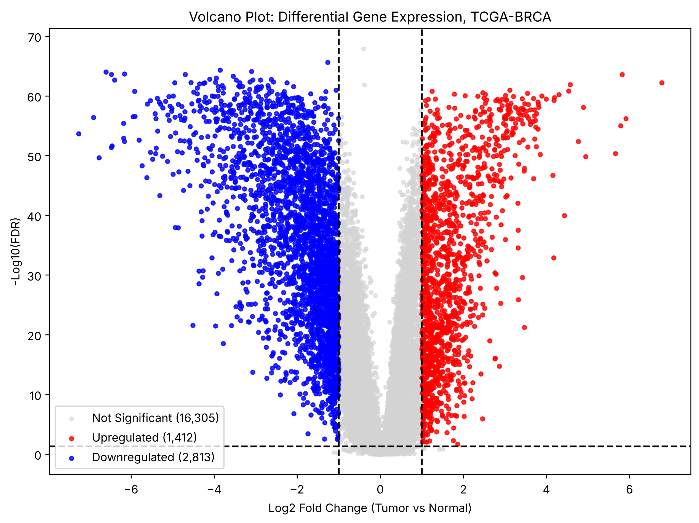
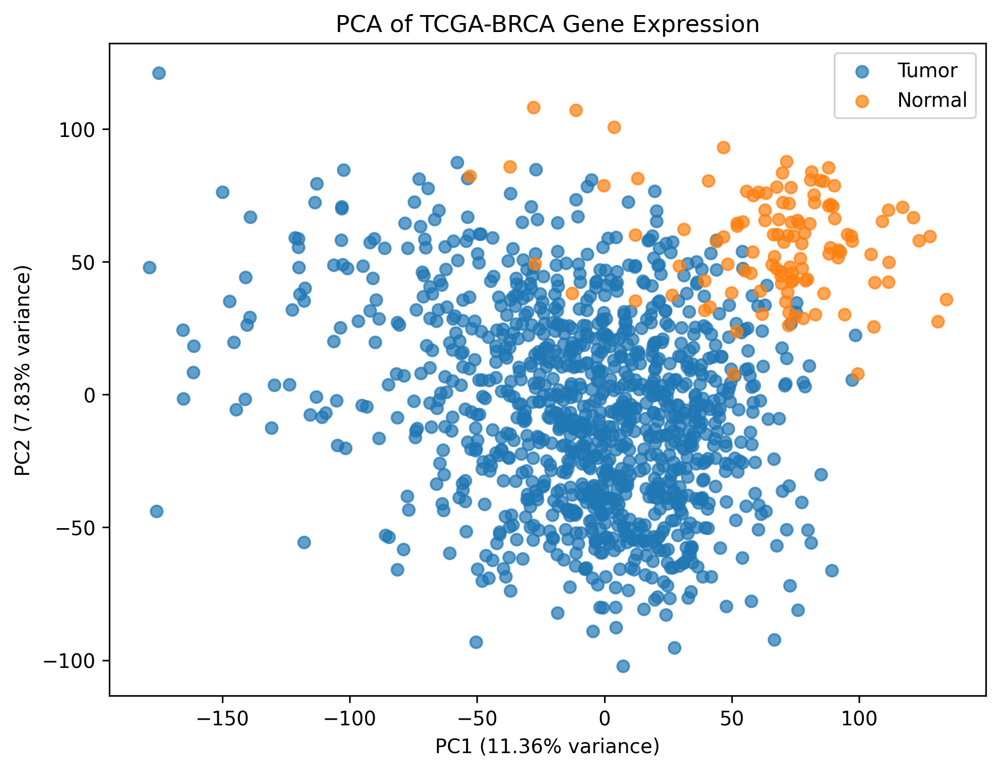

# 🧬 TCGA-BRCA Breast Cancer Gene Expression Analysis

## End-to-End Bioinformatics Pipeline Using Databricks and Python

### 👩‍💻 Author

**Ume Abiha**

---

# 📖 Project Overview

This project presents an end-to-end bioinformatics workflow for analyzing breast cancer RNA-seq data from **The Cancer Genome Atlas (TCGA-BRCA)**. The objective is to identify transcriptomic differences between tumor and normal breast tissue using statistical analysis, unsupervised learning, and supervised machine learning.

The workflow was developed in **Databricks** using **Python**.

---

# 🎯 Project Objectives

* Load and preprocess TCGA-BRCA RNA-seq data
* Integrate clinical metadata
* Annotate tumor and normal tissue samples
* Perform exploratory data analysis
* Run genome-wide differential gene expression analysis with FDR correction
* Visualize results with a volcano plot
* Reduce dimensionality with Principal Component Analysis (PCA)
* Cluster samples with K-Means and compare clusters with PAM50 subtypes
* Build and evaluate a Logistic Regression classifier for tumor prediction

---

# 📂 Data

**Source:** [UCSC Xena](https://xenabrowser.net/datapages/?cohort=TCGA%20Breast%20Cancer%20(BRCA)), TCGA Breast Cancer (BRCA) cohort

| File | Content |
| --- | --- |
| `HiSeqV2` | Gene expression (IlluminaHiSeq RNA-seq), RSEM normalized, log2(count + 1) |
| `TCGA.BRCA.sampleMap_BRCA_clinicalMatrix` | Clinical metadata: age, receptor status, stage, PAM50 subtype, survival |

* 20,530 genes
* 1,211 samples used: 1,097 primary tumor (`-01`) and 114 normal tissue (`-11`)
* 7 metastatic samples (`-06`) excluded

The raw data files are not stored in this repository because of their size (see **How to Run**).

---

# 🛠 Technologies Used

* Python
* Databricks
* pandas
* NumPy
* SciPy
* scikit-learn
* Matplotlib

---

# 🔬 Analysis Workflow

1. Data loading
2. Data cleaning and preprocessing
3. Clinical metadata integration
4. Sample annotation (tumor vs normal)
5. Exploratory data analysis and single-gene test (HIF3A)
6. Genome-wide differential expression: Mann-Whitney U test, log2 fold change, Benjamini-Hochberg FDR
7. Volcano plot
8. Principal Component Analysis (PCA)
9. K-Means clustering, compared with PAM50 subtypes
10. Logistic Regression classification with imbalance-aware metrics and leakage-free cross-validation

---

# 📊 Key Results

**Differential expression** (FDR < 0.05 and |log2FC| > 1)

* **4,225** differentially expressed genes: **1,412 upregulated** and **2,813 downregulated** in tumor
* Top upregulated: COL10A1, COL11A1, MMP11, MMP13, CST1 (extracellular matrix and invasion genes)
* Top downregulated: LEP, ADH1B, ADIPOQ, CA4, TUSC5 (many adipocyte genes, which partly reflects the fat-rich composition of normal breast tissue)



**PCA and clustering**

* PCA largely separates normal samples (high PC1 and PC2) from tumors, with some overlap that reflects tumor heterogeneity
* The two K-Means clusters do not correspond to tumor vs normal. Compared with PAM50 subtypes, cluster 0 is dominated by Luminal A (373 samples) and Normal-like (110), while cluster 1 holds most Basal-like tumors (81 of 141). The main structure on PC1/PC2 therefore reflects molecular subtype as well as tissue type



**Classification** (Logistic Regression on PC1 and PC2, 243 held-out test samples)

| Metric | Value |
| --- | --- |
| Accuracy | 98.4% |
| Balanced accuracy | 95.2% |
| ROC-AUC | 0.996 |
| Baseline (always predict "Tumor") | 90.5% |

Because only about 9% of samples are normal, balanced accuracy and ROC-AUC are the more informative metrics.

**Leakage-free 5-fold cross-validation** (scaling and PCA fitted inside each fold): accuracy 97.6% ± 1.2, balanced accuracy 91.6% ± 4.7, ROC-AUC 0.988 ± 0.007. These slightly lower numbers are the more honest estimate of performance on new samples.

---

# 🚀 How to Run

1. Download `HiSeqV2` and `TCGA.BRCA.sampleMap_BRCA_clinicalMatrix` from the [UCSC Xena TCGA-BRCA cohort](https://xenabrowser.net/datapages/?cohort=TCGA%20Breast%20Cancer%20(BRCA)) and unzip them.
2. Put both files in a `data/` folder at the root of this repository, or upload them to your Databricks workspace.
3. Open `notebook/TCGA_BRCA_Data_Analysis.ipynb` in Databricks or Jupyter. If your data is elsewhere, change `DATA_DIR` in the first code cell.
4. For a local run, install the dependencies first:

```bash
pip install -r requirements.txt
```

5. Run all cells. Figures are written to `figures/` and result tables to `results/`.

---

# 📁 Repository Structure

```text
tcga-brca-gene-expression-analysis/
├── README.md
├── LICENSE
├── requirements.txt
├── notebook/
│   └── TCGA_BRCA_Data_Analysis.ipynb
├── figures/
│   ├── volcano_plot.png
│   ├── pca_plot.png
│   ├── kmeans_plot.png
│   └── confusion_matrix.png
└── results/
    ├── dge_results.csv      # all 20,530 genes: means, log2FC, p-value, FDR, significance
    └── pca_results.csv      # PC1, PC2, sample type and cluster for each sample
```

---

# ⚠️ Limitations

* The Mann-Whitney U test treats tumor and normal samples as independent, although many normal samples are paired with a tumor from the same patient.
* Count-based methods such as DESeq2 or limma-voom are the standard for publication-level differential expression.
* Tumor vs normal classification is a relatively easy task; subtype, stage or survival prediction would be more clinically useful.

---

# 🔭 Future Improvements

* Gene Ontology (GO) and KEGG pathway enrichment of the differentially expressed genes
* Paired tumor-normal analysis and a DESeq2 comparison
* Additional models such as Random Forest and XGBoost
* Survival analysis using the clinical outcomes

---

# 📜 License

This project is licensed under the MIT License.
